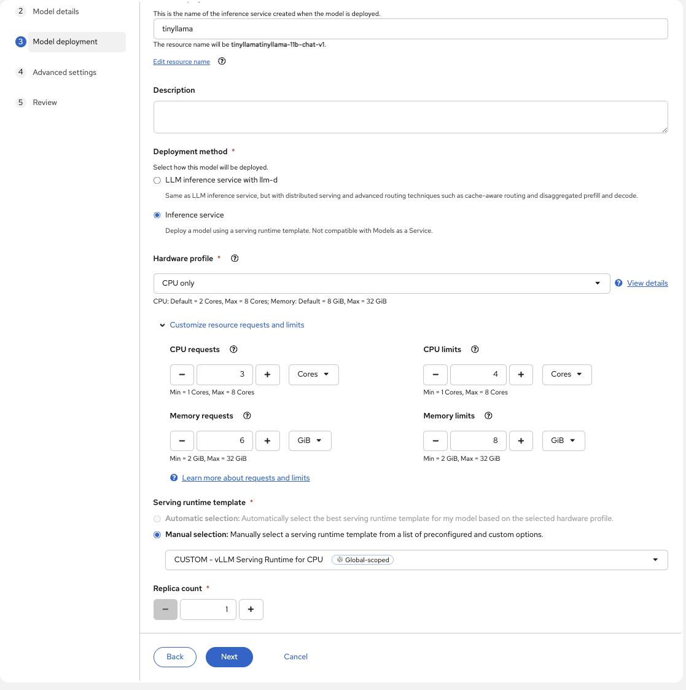
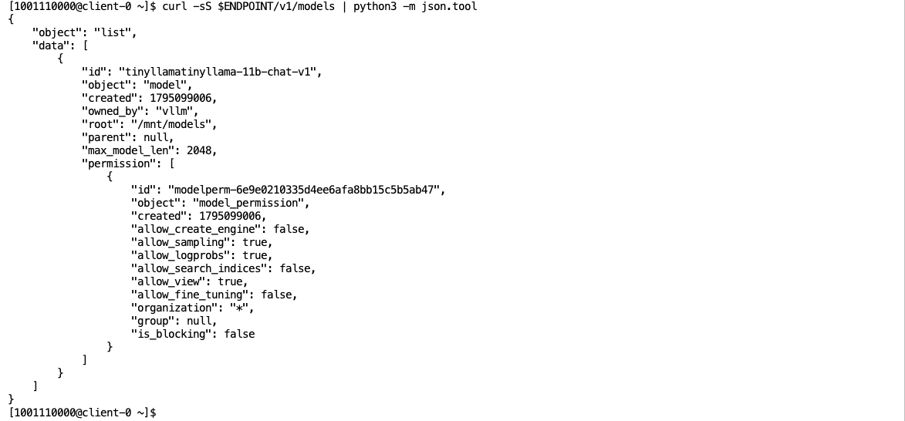

# Lab 1: Serve an LLM on OpenShift AI (70 min)

<span class="chip lab">Lab · 70 min</span>


You run your own large language model inside the cluster: no external API, your data stays on
your infrastructure. GPUs are scarce, so we start where many teams start: a small model on CPU,
served by **vLLM** through **KServe**, OpenShift AI's model serving. The steps are the same with a
bigger model on a GPU; only the size, the runtime and the hardware profile change.

**You will:** read a model card, deploy TinyLlama 1.1B from the model catalog, call it with `curl`
and the OpenAI Python client, and break it on purpose to see how vLLM reports a bad setting.

Values from your instructor: `<USER_NAME>`, your password, `<CLUSTER_DOMAIN>`.
Your project for this lab: **`<USER_NAME>-serving`**.

---

## 1. Which model fits? (10 min)

Every well-documented model on [Hugging Face](https://huggingface.co/models) has a **model card**.
What to look for:

| Section | What to look for |
|---|---|
| Architecture | Llama, Mistral, Granite, …: decides which runtimes support it |
| Size (parameters) | more parameters: usually more capable, always more memory |
| Intended use | chat, instruction following, code, embeddings |
| Context length | the longest prompt + answer the model was trained for |
| License | allowed for your use? |
| Hardware | CPU possible, GPU required, memory needed |

A rough sizing guide (16-bit weights; quantized models need less):

| Model size | GPU memory | Examples |
|---|---|---|
| < 3B parameters | ~8–12 GB, or CPU only | TinyLlama 1.1B, Granite 2B |
| 3B–7B | ~16–24 GB | Llama 3.2 3B, Mistral 7B |
| 7B–13B | ≥ 24 GB | Llama 3.1 8B |
| > 30B | several GPUs | Llama 3.1 70B |

Open the card of [TinyLlama/TinyLlama-1.1B-Chat-v1.0](https://huggingface.co/TinyLlama/TinyLlama-1.1B-Chat-v1.0)
and note its **context length** (you need it in step 5) and its license.

## 2. Deploy TinyLlama (15 min)

1. Log in to the OpenShift AI dashboard: `https://rh-ai.<CLUSTER_DOMAIN>` (your user name and password).
2. Go to **AI hub → Models**, tab **Catalog**, and pick **Workshop models** in the row of categories (next to *Red Hat AI models* and *Other models*).
   Open **TinyLlama-1.1B-Chat-v1.0**, read the card, then click **Deploy model**. A five-step wizard opens:
   > Not in the catalog? Go to your project → **Models → Deploy model** and choose
   > **URI** as the model location with `oci://quay.io/rh-aiservices-bu/tinyllama:1.0`. The rest is the same.
3. **Preconfigure deployment**: project **`<USER_NAME>-serving`**.
4. **Model details**: already filled from the catalog: location **URI** `oci://quay.io/rh-aiservices-bu/tinyllama:1.0`,
   model type **Generative AI model**. Nothing to change.
5. **Model deployment**:
   - Model deployment name: your **`<MODEL_NAME>`**, e.g. `tinyllama`. The resource name below it is generated from
     the catalog name (e.g. `tinyllamatinyllama-11b-chat-v1`): click **Edit resource name** and give it the same value.
     From here on, `<MODEL_NAME>` in this guide means that name: it is also your model id and part of the endpoint

     

     *Here the resource name is still the generated one: click **Edit resource name** and set it to your `<MODEL_NAME>`.*

   - Deployment method: **Inference service** (not *LLM inference service with llm-d*: that one is for distributed serving)
   - Hardware profile: **CPU only**; expand **Customize resource requests and limits**:
     CPU requests **3**, CPU limits **4**; memory requests **6 GiB**, memory limits **8 GiB**
   - Serving runtime template: **Manual selection** → **CUSTOM - vLLM Serving Runtime for CPU**
   - Replica count **1**
6. **Advanced settings**:
   - Model access (external route) and Token authentication: leave **off**; the model stays reachable only inside
     the cluster
   - Configuration parameters: leave **Add custom runtime arguments** unticked for now (you use it in part 5)
   - Deployment strategy: **Recreate** (one pod at a time: fits your CPU quota, and makes part 5's failure visible)
   - Optional: tick **Add as AI asset endpoint** to also chat with your model in **Gen AI studio → Playground**
7. **Review** → **Deploy**, and wait until the status is **Started** (a few minutes: the model image is pulled first).

What happened: OpenShift AI created a KServe `InferenceService` in your project; KServe started a
vLLM pod with the model mounted from the OCI image (a "modelcar").

## 3. Find the endpoint (5 min)

In your project → **Models**, click **Internal endpoint** next to `<MODEL_NAME>` and copy the URL.
It looks like:

```
http://<MODEL_NAME>-predictor.<USER_NAME>-serving.svc.cluster.local[:port]
```

The API is OpenAI-compatible, under `/v1`.

## 4. Call your model (15 min)

1. In `<USER_NAME>-serving` → **Workbenches → Create workbench**: name `client`, image
   **Jupyter | Minimal | CPU | Python 3.12** (or Data Science), the smallest size. Start it and open it.
2. Open a **Terminal** in JupyterLab. Set **your** endpoint, the **Internal endpoint** you copied in part 3
   (without `/v1`), and list the models it serves:

   ```bash
   export ENDPOINT=http://<MODEL_NAME>-predictor.<USER_NAME>-serving.svc.cluster.local   # your copied URL
   curl -sS $ENDPOINT/v1/models | python3 -m json.tool
   ```

   

   *Example answer. The model `id` is the resource name of the deployment: here it was left at the generated name
   (`tinyllamatinyllama-11b-chat-v1`); yours shows your `<MODEL_NAME>`.*
   `curl: (6) Could not resolve host` means the address does not match your deployment: copy it again.

   Keep the id in a variable, so the next commands use whatever your deployment is called:

   ```bash
   export MODEL=$(curl -sS $ENDPOINT/v1/models | python3 -c 'import sys, json; print(json.load(sys.stdin)["data"][0]["id"])')
   echo $MODEL
   ```

3. A chat completion:

   ```bash
   curl -sS $ENDPOINT/v1/chat/completions -H 'Content-Type: application/json' -d @- <<EOF | python3 -m json.tool
   {"model": "$MODEL",
    "messages": [{"role": "system", "content": "You are a helpful assistant."},
                 {"role": "user", "content": "In two sentences: what is Kubernetes?"}],
    "max_tokens": 100}
   EOF
   ```

   Slower than a cloud endpoint: CPU inference. Note `usage` in the answer (prompt and completion tokens).

4. The same from Python, with the OpenAI client, in a notebook: **File → New → Notebook** (Python 3). The minimal
   image does not include the client, so the first cell installs it:

   ```python
   %pip install -q openai
   ```

   Then, in a new cell, with **your** endpoint (the URL you copied) and **your** model id (`echo $MODEL` in the
   terminal shows it):

   ```python
   from openai import OpenAI
   ENDPOINT = "http://<MODEL_NAME>-predictor.<USER_NAME>-serving.svc.cluster.local"   # your copied URL
   MODEL = "<MODEL_NAME>"                                                              # your model id
   client = OpenAI(base_url=ENDPOINT + "/v1", api_key="none")
   r = client.chat.completions.create(model=MODEL,
         messages=[{"role": "user", "content": "Give me three names for a cat."}], max_tokens=60)
   print(r.choices[0].message.content)
   ```

   Any application that speaks the OpenAI API can use your model this way, with only the base URL changed.

## 5. Break it on purpose (15 min)

vLLM reserves memory for the longest context it will accept (`--max-model-len`). Ask for more than
the model supports and it refuses to start, with a clear message.

1. **AI hub → Models → Deployments** (or your project → **Models**) → `<MODEL_NAME>` → ⋮ → **Edit**.
2. In **Advanced settings**, tick **Add custom runtime arguments** and enter `--max-model-len=8192`
   (TinyLlama's card says 2048). Save / **Redeploy**.
   > `exceeded quota: lab-quota` instead? The deployment uses **Rolling update**, which starts the new pod next to the
   > old one and goes over your CPU quota. Edit again → **Advanced settings** → Deployment strategy **Recreate** → save.
3. Watch it fail. The dashboard only says *Deployment does not have minimum availability*; the reason is in the log:
   OpenShift console → project `<USER_NAME>-serving` → **Workloads → Pods** →
   the `<MODEL_NAME>-predictor-…` pod (status *Error*, restarting) → **Logs**. Find the line that explains why
   (it names the model's maximum length).
4. Edit again, untick **Add custom runtime arguments** (or remove the argument) and redeploy; the status returns to **Started**.

On a GPU the same setting decides how much GPU memory vLLM takes for the KV cache; too high is the
most common reason a model does not start.

## Checkpoint

- `<MODEL_NAME>` is **Started** in `<USER_NAME>-serving`
- you got a chat completion from it with `curl` and with the OpenAI client
- you saw, and can explain, the `--max-model-len` failure

## If something goes wrong

- Stuck in **Pending**: not enough CPU in your quota or on the nodes; check the pod's events, or lower the CPU request to 2.
- No catalog entry: deploy from the URI (step 2).
- Your model won't start: use the instructor's model endpoint for steps 4–5 and come back to it.
