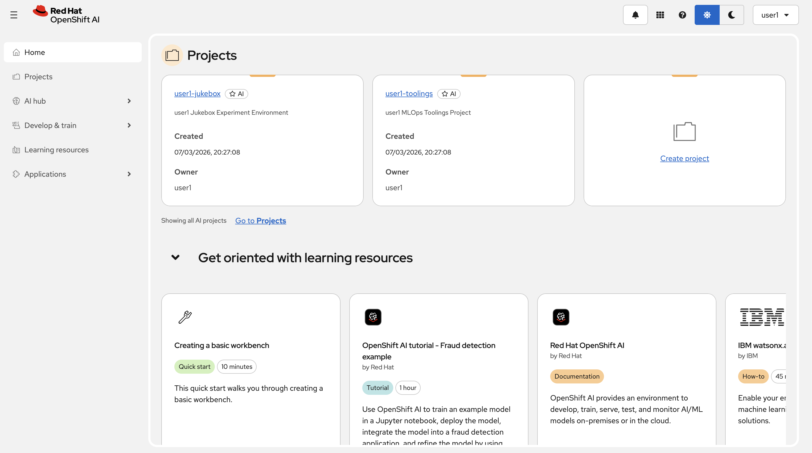
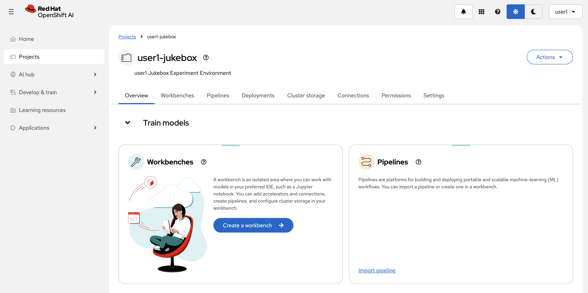
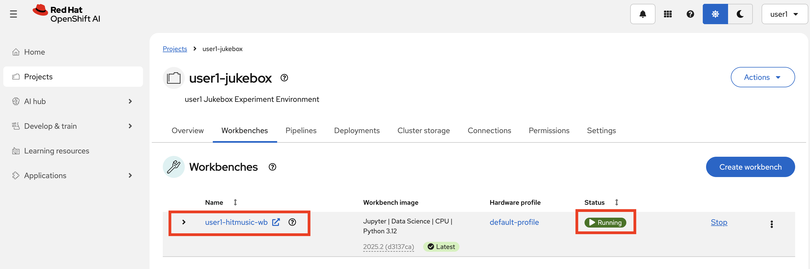
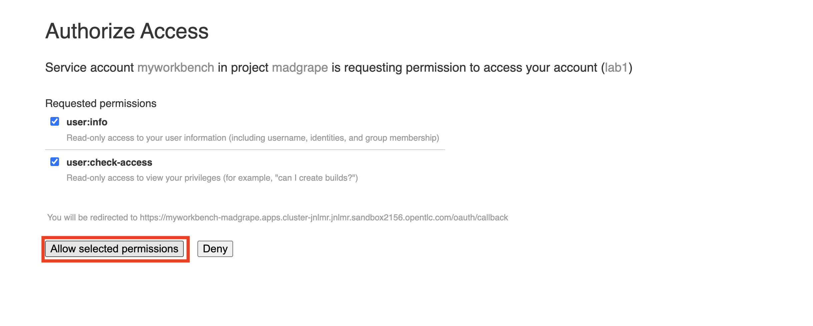
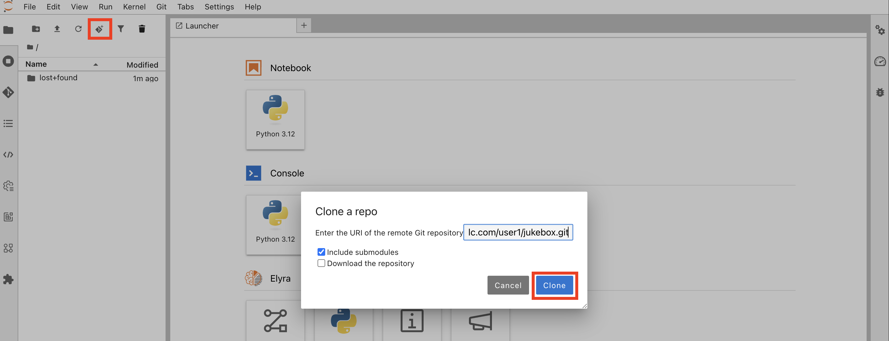
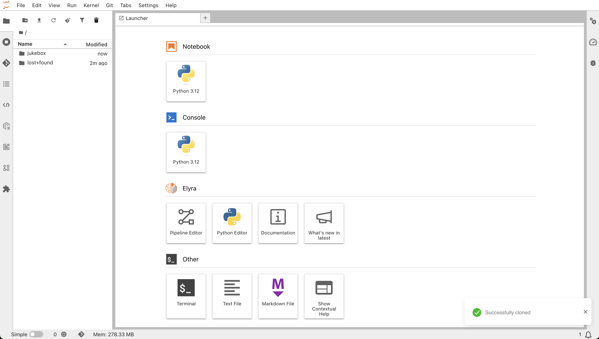

## Data Science Project

1. Log in to [OpenShift AI](https://rh-ai.<CLUSTER_DOMAIN>) with your workshop user. Under `Projects` you'll see one project per lab, already created for you.



2. Click on the `<USER_NAME>-jukebox` project. This project will be the place where we start experimenting, training and deploying our model.



3. Let's create a notebook. Click `Create a Workbench`. OpenShift AI Dashboard is pretty intuitive, isn't it? :)

   Select a name you want, could be something like `<USER_NAME>-hitmusic-wb` 🎺

    **Notebook Image:** 

    - Image selection: `Jupyter | Data Science | CPU | Python 3.12`
    - Version selection: the newest (`3.5`)
  
    **Deployment size**
    - Hardware profile: `CPU only`
    - Expand `Customize resource requests and limits` to increase `Memory`:
      - **Memory requests:** `6 GiB`
      - **Memory limits:** `8 GiB`

    **Environment variables**
    - Click `Add variable` > choose `Config Map` > `Key / value` and add below values:
      - **Key:** `PIP_INDEX_URL`
      - **Value:** `https://pypi.org/simple`

    **Cluster storage**
    - Leave it as max 20 GiB.

    **Connections**
    - Click `Attach existing connections`, select **`models`** (only this one) and click `Attach`.
      The other connections (data, pipeline, ...) are used later by the pipelines, not by the workbench.
       
..and finally, hit `Create workbench`.

4. When the status of the new workbench indicates `Running`, click on the name of the workbench to access.

    

<!-- 
    It will open up the Jupyter Notebook UI. You need to use your credentials again to log in. If you see the below screen, click `Allow selected permissions`. That will redirect you to your Jupyter Notebook.

    
-->

5. Your `jukebox` repository (notebooks and code) is already in the Git server: [https://<GIT_SERVER>](https://<GIT_SERVER>), same username and password.

6. In your workbench, click the Git icon and **clone** your copy:

    ```bash
    https://<USER_NAME>:<PASSWORD>@<GIT_SERVER>/<USER_NAME>/jukebox.git
    ```

    

    After cloning the repository, you should see the `jukebox` folder in the left-hand panel.

    

7. Next: the storage you'll use. 🫡
