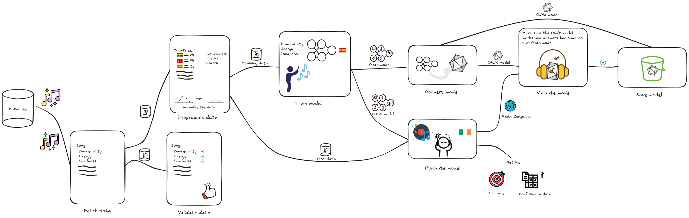
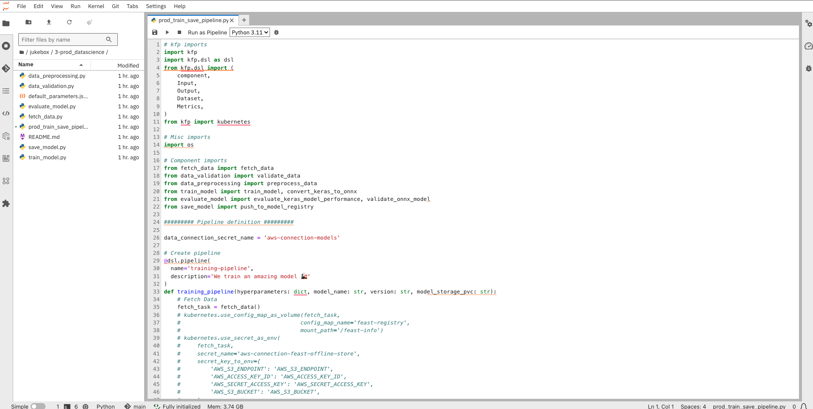
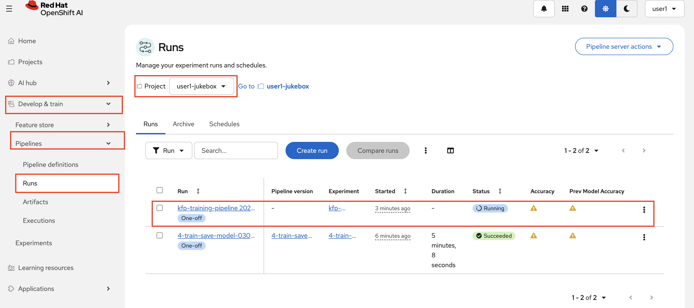
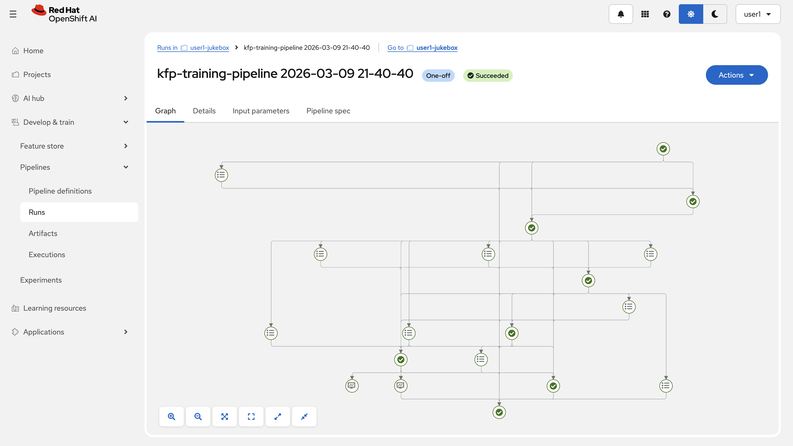

## Kubeflow Pipelines (KFP)

Kubeflow Pipelines (KFP) is a platform designed for building and deploying portable, scalable machine learning pipelines using containers (and no, it's not related to Kung Fu Panda 🐼). KFP provides advanced capabilities such as versioning, metadata tracking, and resource management, which enable teams to monitor and optimize their pipelines efficiently.

KFP offers the robustness we need for running pipelines continuously. With KFP, we can have better logging, error handling, retry logic, and other production-level features. Essentially, this will become our production-grade training pipeline. And it will be automatically triggered based on source code updates, the arrival of new data, or alerts signaling unusual model behavior. (spoiler, spoiler🤭🤭)

The pipeline steps look like this:  


1. First we gather some data that we would like to train our model on.
2. Then we both validate and preprocess the data. They are done in parallel but if the validation step fails, the pipeline will stop.  
The pre-processing step makes sure that everything is converted to numbers and that our data is normalized, just like we did in the inner loop.
3. Once we have our data ready, we can train the model.
4. After the model is trained, we will evaluate the model to make sure its performance is good enough.  
We also convert the model to ONNX at the same time, as that's the format we will go with for serving the model.
5. After obtaining the ONNX model, we ensure that it performs the same as the original Keras model by running the test data through the ONNX model.
6. And finally, we can save the model by storing it somewhere our model server can reach it. 🎉

Now that you know what the pipeline is supposed to do, let's go ahead and run it! 🏃‍♂️

1. You can find the pipeline definition in the `3-prod_datascience` folder.

    If you explore the files in this folder, you'll notice that they largely mirror the steps we previously executed in our notebooks. However, these steps have been broken down into individual functions and organized into separate files to improve modularity. This makes the pipeline easier to update and maintain over time.

    

2. Run it once by hand to see it work (later it is triggered automatically). In your workbench open a **Terminal**
   (File → New → Terminal) and run:

    ```bash
    cd ~/jukebox/3-prod_datascience && python prod_train_save_pipeline.py
    ```

    It prints `Connecting to Data Science Pipelines: https://ds-pipeline-dspa.<USER_NAME>-jukebox.svc:8443` and then
    exits: the pipeline now runs on the cluster. Warnings (`FutureWarning`) can be ignored.

3. In the OpenShift AI dashboard, under `Develop & train`, go to `Pipelines` > `Runs`. You'll see there is one run with the status `Running`. Click to see the details of the pipeline run.

    

    You'll be able to get many details such as:

    - the relationship between the steps
    - the output of each step
    - the artifacts that are generated
    - the metrics and graphs 

    

    Take some time to explore this view and familiarize yourself with its features. The pipeline might take a while to finish on its first run, but you don’t need to wait for it to complete. Feel free to move on to the next steps!

4. Next: [3. The Data Tracks](../5-the-data-tracks/index.md), a small data pipeline.

> 📖🤓 **Extra Info: Component Registry**  
We have quite a few different components used in our pipeline.  
Imagine if we had multiple pipelines using similar components, we then wouldn't want to build each component from scratch for each pipeline.  
Instead, we would look at creating a registry of reusable, modular, components that anyone can import when they build their pipeline.  
Here are a couple of example repositories of how this can look like for kubeflow pipelines:
> - https://github.com/kubeflow/pipelines-components
> - https://github.com/red-hat-data-services/pipelines-components
>
> You can also find more written about this topic in [this article](https://developers.redhat.com/articles/2026/06/03/build-modular-ai-pipelines-openshift-ai-and-reusable-components).

