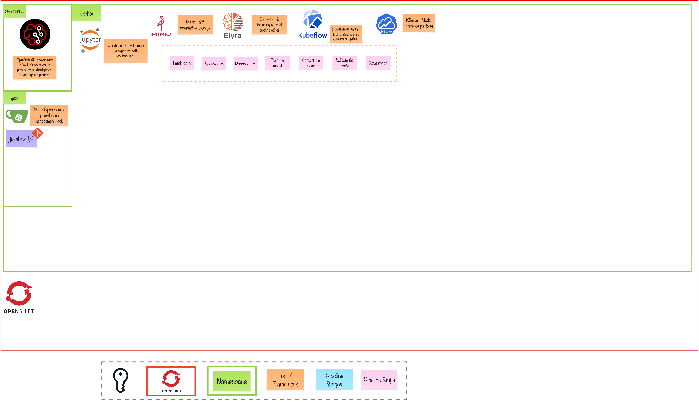

# Exercise 2 - In the Rhythm of Data
> Create a training pipeline with the Kubeflow Pipelines SDK (KFP)

## 👨‍🍳 Exercise Intro

In this exercise, we'll automate the previous steps with Kubeflow Pipelines (KFP), ready for production.

## 🖼️ Big Picture

## 🔮 Learning Outcomes

- [ ] Get familiar with KFP and Data Science Pipelines
- [ ] Execute pipelines from Workbench

## 🔨 Tools used in this exercise
* [Kubeflow Pipelines](https://www.kubeflow.org/docs/components/pipelines/overview/) -  A platform for building and deploying portable and scalable machine learning (ML) workflows using containers
