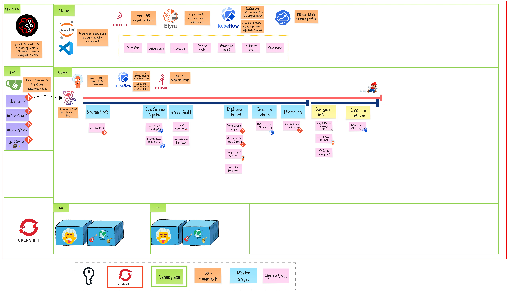

# Demo - From Studio to Stage (GitOps)
> Introduction to MLOps: a set of practices that automate and simplify machine learning workflows and deployments. 

## 👨‍🍳 Exercise Intro
In this instructor demo we create the MLOps environment with Argo CD and deploy the model to test and prod through GitOps.

## 🖼️ Big Picture

## 🔮 Learning Outcomes

- [ ] Get familiar with MLOps concept
- [ ] Deploy the necessary toolings to build & deploy models automatically
- [ ] Understand tracking important metadata

## 🔨 Tools used in this exercise
* [OpenShift GitOps](https://argoproj.github.io/argo-cd/) - A controller which continuously monitors application and compares the current state against the desired state
* [Kubeflow Model Registry](https://www.kubeflow.org/docs/components/model-registry/) - Provides a central index for Machine Learning model metadata