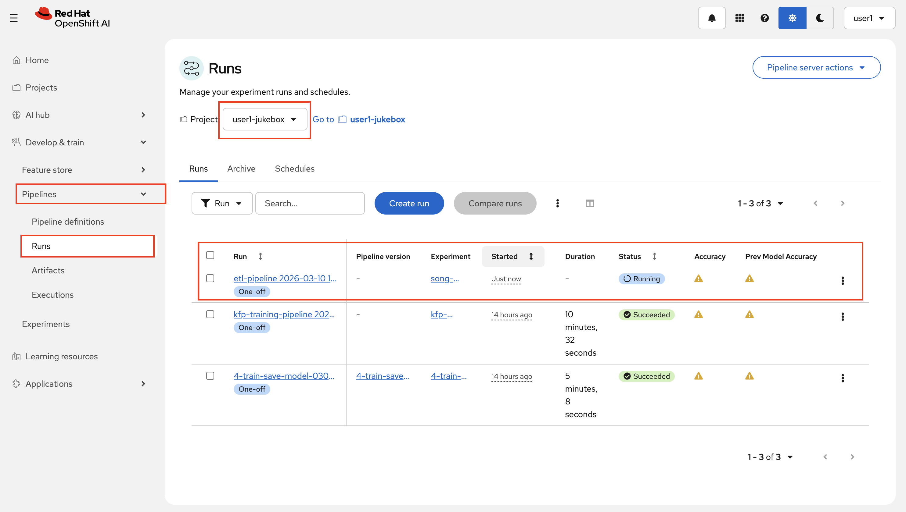
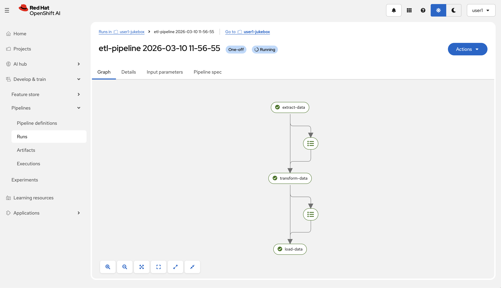

# Data Pipeline (tiny ETL)

Before we start versioning the data, we need to have it somewhere we control. Besides GitHub not being the best place for storing data, because of the max storage limit they have, we may also want to store it inside our cluster.

For this, we will have a S3 bucket that can hold our data, and we will version the data inside that bucket.

Let's start by moving some data into the bucket.

1. In your workbench terminal, run the pipeline `jukebox/5-data-versioning/1-data_pipeline_url_to_s3.py`. It copies
   the song properties data from GitHub into your S3 bucket `data`:

    ```bash
    cd ~/jukebox/5-data-versioning && python 1-data_pipeline_url_to_s3.py
    ```

    This will trigger the pipeline that you can view in the dashboard under `Develop & train` > `Pipelines` > `Runs` in your `<USER_NAME>-jukebox` project.

    

    Let's wait for it to complete successfully.

    
