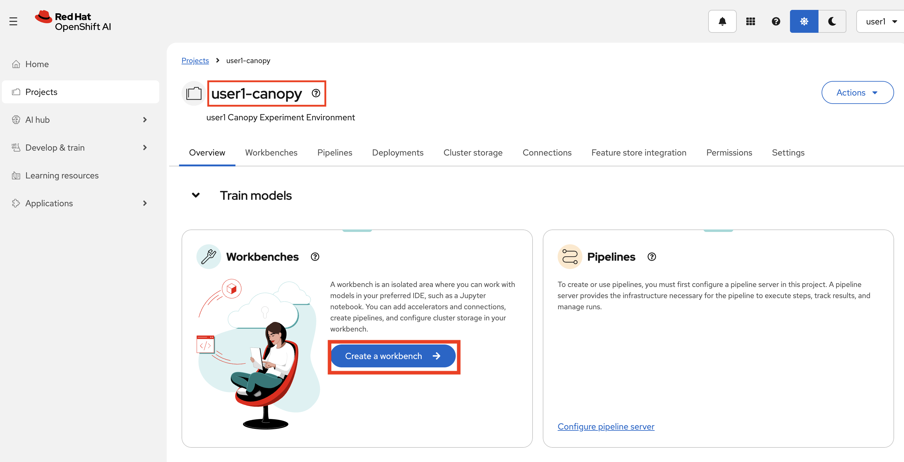
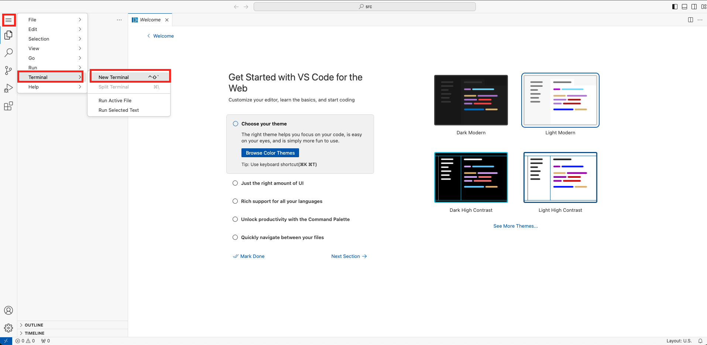

# Before you start

**Coming from Lab 4?** Open your `<USER_NAME>-canopy` workbench again (OpenShift AI → project
`<USER_NAME>-canopy` → Workbenches). The notebooks for this activity are in `experiments/7-guardrails/`,
in the same clone. Continue with the next page.

**Starting here?** Set up the workbench:

1. Open OpenShift AI: `https://rh-ai.<CLUSTER_DOMAIN>` (your user name and password).
2. Project **`<USER_NAME>-canopy`** → **Create a workbench**: name `<USER_NAME>-canopy`, image
   **GenAI Labs Code Server**, the default CPU hardware profile. Open it when it is **Running**.

   

3. Hamburger menu → **Terminal** → **New Terminal**, then clone your copy of the notebooks:

   ```bash
   git clone https://gitea-gitea.<CLUSTER_DOMAIN>/<USER_NAME>/experiments.git
   ```
   When asked, log in with your user name and password.

   

Already there for everyone (namespace `ai501`): the Llama 3.2 model at
`http://llama-32-predictor.ai501.svc.cluster.local:8080`, and the detectors NeMo calls.

Next: [Prompt-level guardrails](1-prompt-guardrails.md)
