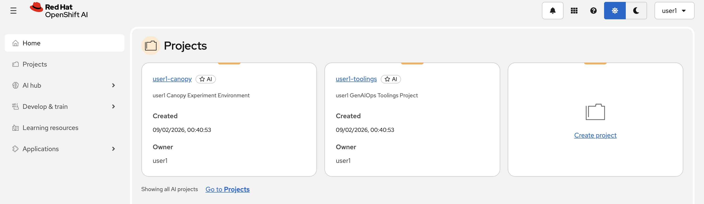
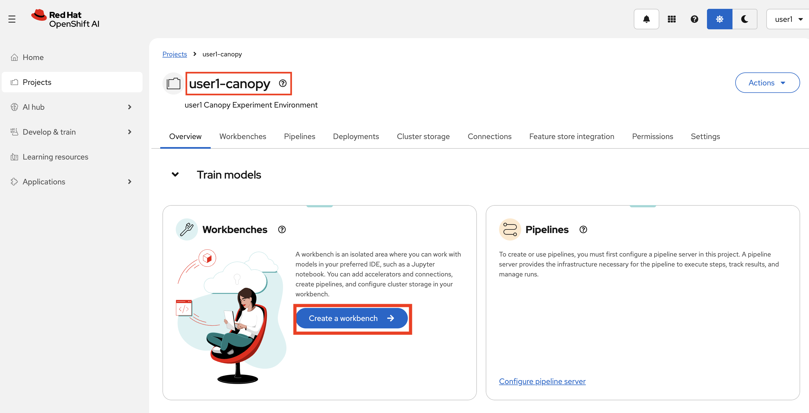
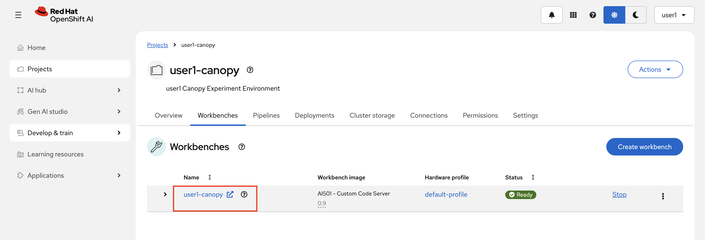
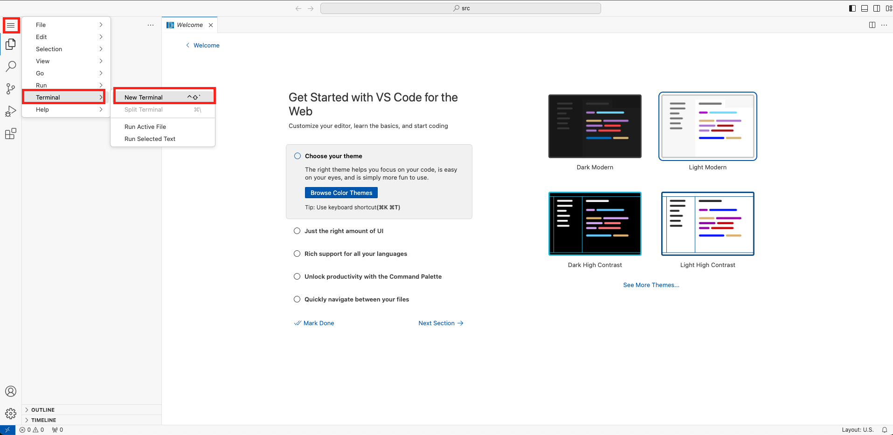
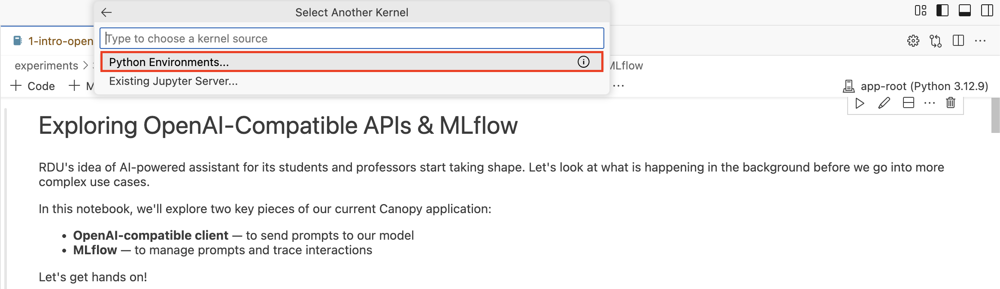
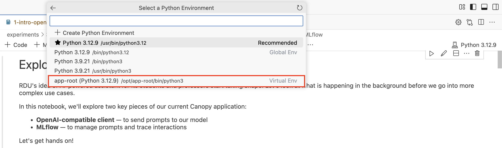

# Before you start: workbench and notebooks

You set up the workbench once here and keep using it in Lab 5.

1. Open OpenShift AI: `https://rh-ai.<CLUSTER_DOMAIN>` (user `<USER_NAME>`, password `<PASSWORD>`).

   

2. Click the **`<USER_NAME>-canopy`** project, then **Create a workbench**.

   

3. Fill in:
   - Name: `<USER_NAME>-canopy`
   - Image: **GenAI Labs Code Server**
   - Hardware profile: the default CPU profile
   - Storage and connections: leave as they are

   **Create workbench**. When the status is **Running**, open it by clicking its name.

   

4. Open a terminal: hamburger menu (top left) → **Terminal** → **New Terminal**.

   

5. Clone your copy of the notebooks from the workshop's Git server:

   ```bash
   git clone https://<USER_NAME>:<PASSWORD>@gitea-gitea.<CLUSTER_DOMAIN>/<USER_NAME>/experiments.git
   ```

6. The notebooks for this lab are in `experiments/5-rag/`. When you run the first cell of a notebook,
   choose the first kernel option, then the `Virtual Env` Python environment.

   
   

   Your copy of the notebooks already has your user name and the cluster domain filled in (`username = "<USER_NAME>"`,
   `cluster_domain = "<CLUSTER_DOMAIN>"`); just check them when a cell asks.

Already prepared in your project: **Milvus** (vector database, Helm release `milvus`, with its web UI
**Attu**) and a **Llama Stack** instance (`llama-stack-service`) connected to the workshop's Llama 3.2
model and to your Milvus. Shared by everyone: the **Docling** document converter.

Next: [Try RAG in the Playground](1-intro-to-rag.md)
