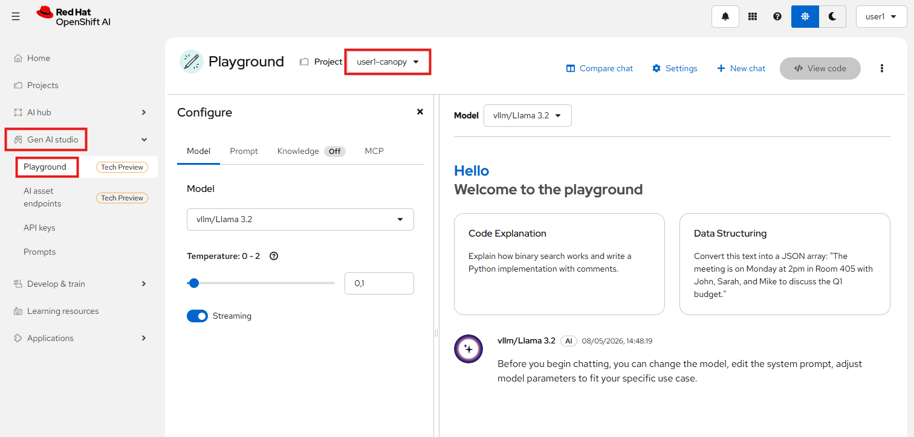
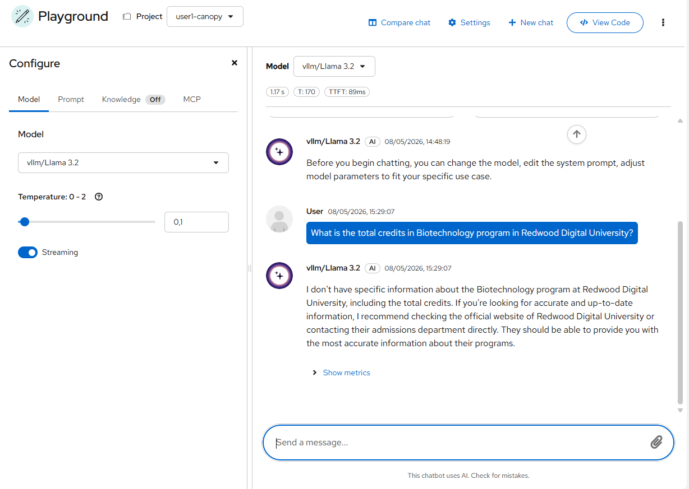
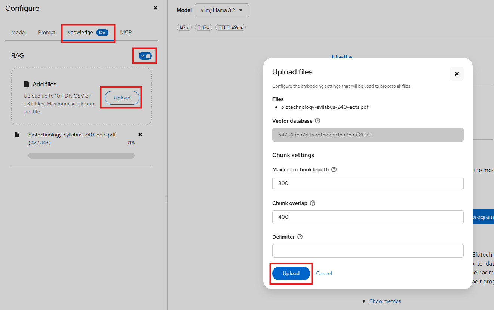
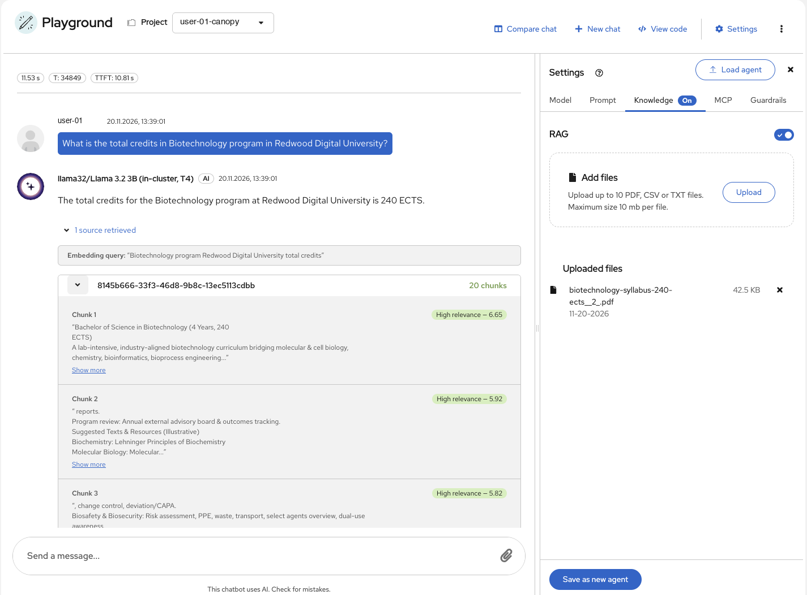

# Try RAG at the playground

RAG allows us to "ground" our answers in some information, prompting the model to answer based on that information rather than hallucinating.  

This is done by sending this extra information/context in together with the prompt, and adding extra instructions to primarily looking at that information before answering any question.  

Let's try it out!

First things first, did you know that we (RDU) has a website? Go check it out: [https://rdu-website-ai501.<CLUSTER_DOMAIN>/](https://rdu-website-ai501.<CLUSTER_DOMAIN>/)

Browse the programs in the "Academic Excellence" section, and download the syllabus for your favorite programs by clicking the "Learn More" link. Once on a program page, click "Download Program Info Sheet (PDF)" to download it! We will be asking our LLM about it ;)

1. Go to OpenShift AI Dashboard > Gen AI studio > Playground > and make sure you have <USER_NAME>-canopy selected as the project.

    

    The first time, the page offers **Create playground**: in **Configure playground** tick only **Llama 3.2 3B**, leave **Max tokens** empty (it limits the length of the answer, not of the question) and click **Create**. Its status shows `?`: it is the workshop's shared model, added to your project as an endpoint, so the page cannot check it; that is fine. It takes a minute or two to start.

2. Try asking a question, such as `What is the total credits in Biotechnology program in Redwood Digital University?` or something similar (for whatever course you picked).

    

    Doesn't give a very specific or correct answer, does it? Let's try to fix that!

3. Go over to the Knowledge tab, swap RAG to on and add the PDF you downloaded before from the RDU website.  

    You will get a modal asking you what chunk length and overlap you want. We will come back to what these are later, but keep them in mind as they are very important settings.  

    Keep the default chunk settings and press `Upload`.

    

    Note: if it's stuck at 50% then just give it a few minutes and refresh the page. It should show up as an Uploaded file when you go to the Knowledge tab after the refresh.

4. Wait for the upload to finish and then try asking the same thing again. Do you get a better answer this time? You should see the response is ✨ grounded ✨ on the PDF you provided :)

    > **"Something went wrong … 400 Bad Request"?** The question plus the PDF chunks the search added were too long
    > for the model (the chat history counts too). Click **New chat** (top right) and ask the question again, as the
    > only question in that chat. Ask one question per chat while Knowledge is on.

Now that we have seen RAG in practice, let's build it ourselves, step by step.

Next: [Understanding embeddings](2-rag-basics.md)

---

**What a successful answer looks like** (Knowledge on, one question in a new chat): the answer cites 240 ECTS, and
"1 source retrieved" lists the PDF chunks it used.

