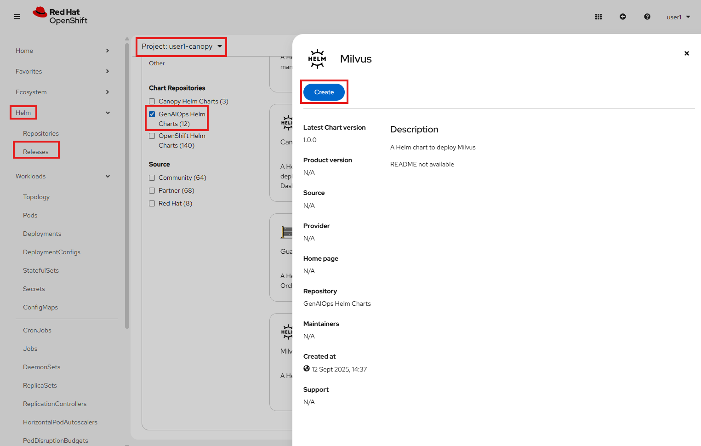
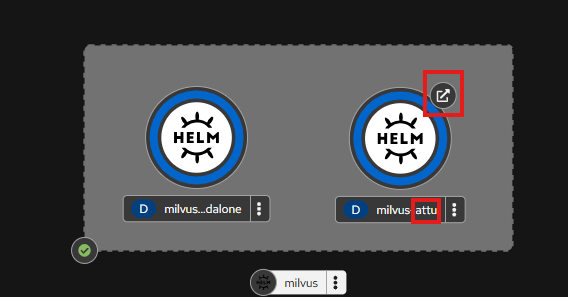
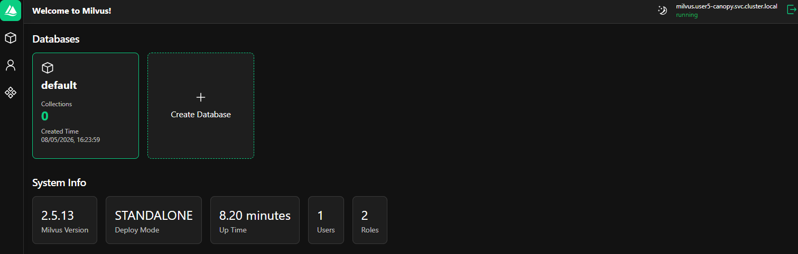

# Vector Databases - Milvus

Now that we know what embeddings are, we need to be able to store and search them somewhere, preferably that's not just local.
For this, we will use Milvus, a high-performant opensource **Vector Database** (as we saw in the previous chapter, embeddings are vectors so they fit perfectly with a vector database).
Vector databases are optimized to store and search across millions of vectors efficiently.

## Using Milvus

1. Milvus is already deployed in your project. In the OpenShift console, go to **Helm → Releases**
   (project `<USER_NAME>-canopy`): you see the release **`milvus`**. It is the same chart you would install
   yourself from **Create Helm Release → GenAIOps Helm Charts → Milvus**.

   

2. Together with Milvus runs **Attu**, the web frontend for Milvus, which we can use to browse the
   vectors we store. Open it from **Networking → Routes** (route `milvus-attu`) or the Topology view.

   

3. To log into Attu, use the following Address and Database:
    - Milvus Address: `http://milvus.<USER_NAME>-canopy.svc.cluster.local:19530`
    - Database: `default`

    

    I promise, it will soon look more interesting!

4. Go to your workbench and run through the notebook `experiments/5-rag/2-vector-databases.ipynb`

After you are done with the notebook you can continue to learn about Docling, which will teach you ways
to process more complex documents and formats.

Next: [Document intelligence with Docling](4-docling.md)
