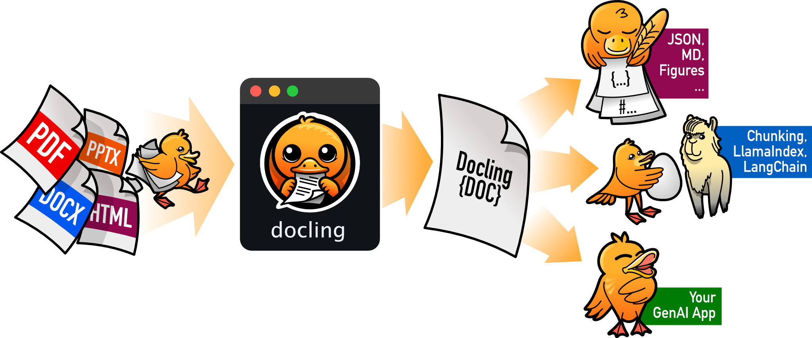

# Document Intelligence with Docling
It's not always just text that we want to ask about in our RAG application, sometimes it's images, diagrams, tables, etc.

To be able to process these we can use Docling.

**Docling** enhances your RAG system with an intelligent document processor that understands:

* 📊 **Complex tables** with research data and experimental results
* 🧮 **Mathematical formulas** and scientific notation
* 📈 **Charts and figures** that visualize key concepts
* 📝 **Multi-column layouts** typical of academic papers
* 🏛️ **Document structure** like sections and references
  

## Build Document Intelligence

Let's try it out to see how Docling works in practice!

Go to your workbench and go through the notebook `experiments/5-rag/3-docling.ipynb`.

> **Workshop notes.** The Docling service is shared by everyone and runs on CPU: converting the paper
> takes about a minute (longer if many of you start at the same moment, so be patient with that cell).
> The notebook in your copy already points at this cluster's Llama 3.2 model and skips OCR (the PDF
> has a text layer).

---

Now that we went through below stages hands on:

1. **Chunking** — the uploaded PDF is split into smaller pieces of text.
2. **Embedding** — each chunk is converted into a numerical vector (a list of numbers that captures its meaning) using an embedding model.
3. **Storing** — those vectors are saved in a vector database so they can be searched later.
4. **Retrieving** — when you ask a question, your question is also converted into a vector, and the database finds the chunks most similar to it.
5. **Generating** — the retrieved chunks are sent to the LLM along with your question as context, so the model can answer based on the actual document content rather than its general training data.

...you have done all of it by hand. Next, let Llama Stack do the chunking, embedding, storing and
retrieving for you, behind one API.

Next: [RAG with Llama Stack](5-rag-with-llama-stack.md)
