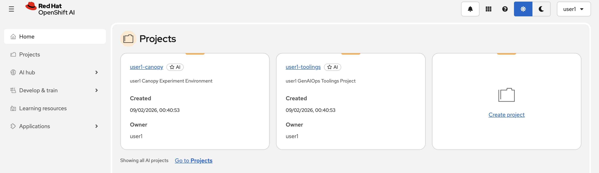
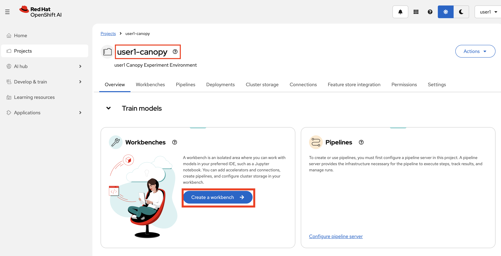
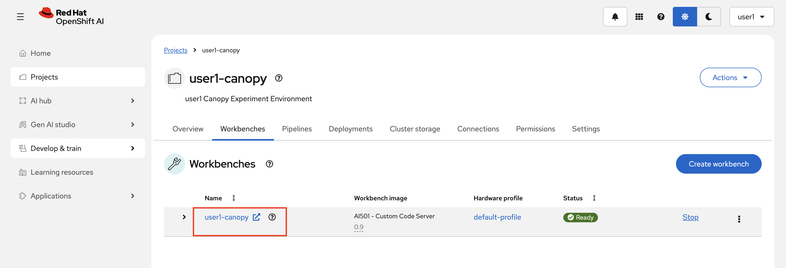
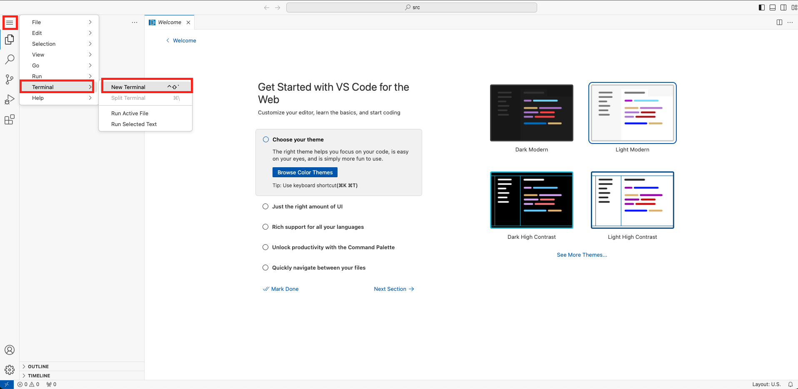
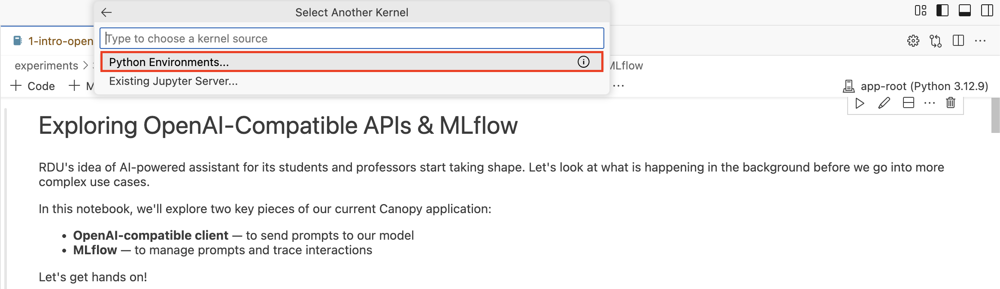
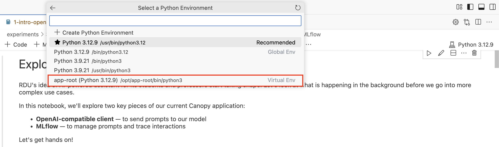

# Before you start: workbench and notebooks

**Coming from Lab 4?** You already have everything: open your `<USER_NAME>-canopy` workbench again
(OpenShift AI → project `<USER_NAME>-canopy` → Workbenches) and go to `experiments/8-agents/`. The
notebooks for this lab are there, in the same clone. Then continue with the next page.

**Starting here?** Set up the workbench as follows.

1. Open OpenShift AI: `https://rh-ai.<CLUSTER_DOMAIN>` (user `<USER_NAME>`, password `<PASSWORD>`).

   

2. Click the **`<USER_NAME>-canopy`** project, then **Create a workbench**.

   

3. Fill in:
   - Name: `<USER_NAME>-canopy`
   - Image: **GenAI Labs Code Server**
   - Hardware profile: the default CPU profile
   - Storage and connections: leave as they are

   **Create workbench**. When the status is **Running**, open it by clicking its name.

   

4. Open a terminal: hamburger menu (top left) → **Terminal** → **New Terminal**.

   

5. Clone your copy of the notebooks from the workshop's Git server:

   ```bash
   git clone https://<USER_NAME>:<PASSWORD>@gitea-gitea.<CLUSTER_DOMAIN>/<USER_NAME>/experiments.git
   ```

6. The notebooks for this lab are in `experiments/8-agents/`. When you run the first cell of a
   notebook, choose the first kernel option, then the `Virtual Env` Python environment.

   
   

Already prepared in your project: a Llama Stack instance (`llama-stack-service`, Helm release
`llama-stack-operator-instance`) connected to the workshop's Llama 3.2 model, and the chart catalogues
**GenAIOps Helm Charts** and **Canopy Helm Charts** under Helm → Create Helm Release.

Next: [Agents in the Playground](0-intro-to-agents.md)
