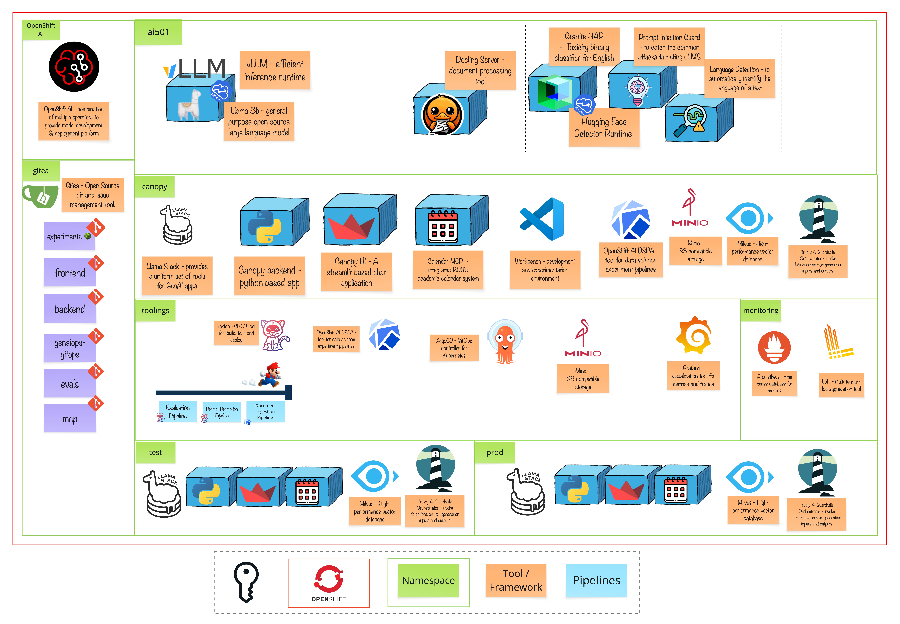

# Lab 5: Agents and MCP (75 min)

Lab · 75 min

You give a language model **tools**: first in the OpenShift AI Playground with a ready-made weather MCP
server, then in code. You call tools from Python, deploy your own **MCP server** (a university
calendar), build a **ReAct agent** from scratch, rebuild it with **LangGraph** on Llama Stack, and finally
see how an MCP server is secured with **OAuth** (Keycloak).

Values from your instructor: `<USER_NAME>`, `<PASSWORD>`, `<CLUSTER_DOMAIN>`.
Your project for this lab: **`<USER_NAME>-canopy`**.

| Step | Page | Time |
|---|---|---|
| 0 | [Before you start: workbench and notebooks](0-before-you-start.md) | 10 min |
| 1 | [Agents in the Playground](0-intro-to-agents.md) | 5 min |
| 2 | [What are tools? MCP servers](1-what-are-tools.md) | 20 min |
| 3 | [Agentic workflows: a ReAct agent](2-agentic-workflows.md) | 15 min |
| 4 | [Agentic frameworks: Llama Stack and LangGraph](3-agentic-llamas.md) | 15 min |
| 5 | [Securing MCP servers (OAuth)](5-securing-mcp-servers.md) | 10 min (or a walkthrough) |

**Checkpoint:** an agent that calls an MCP tool and acts on the result (the calendar meeting it schedules
shows up in your calendar app).
